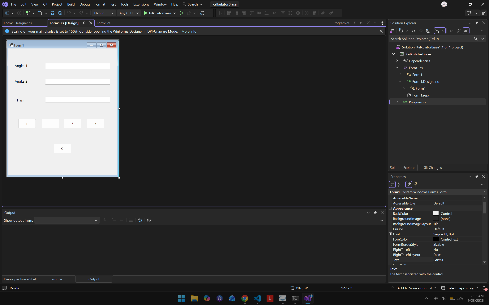
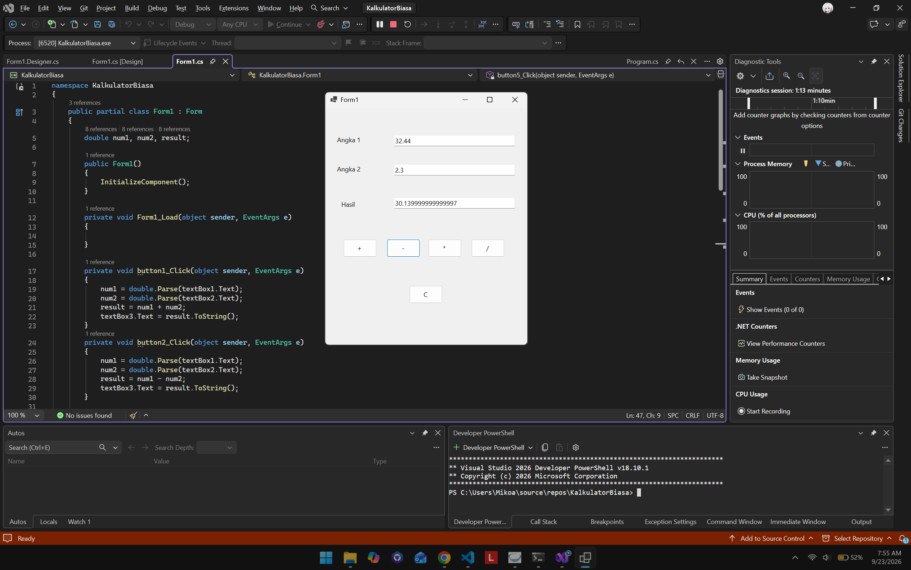
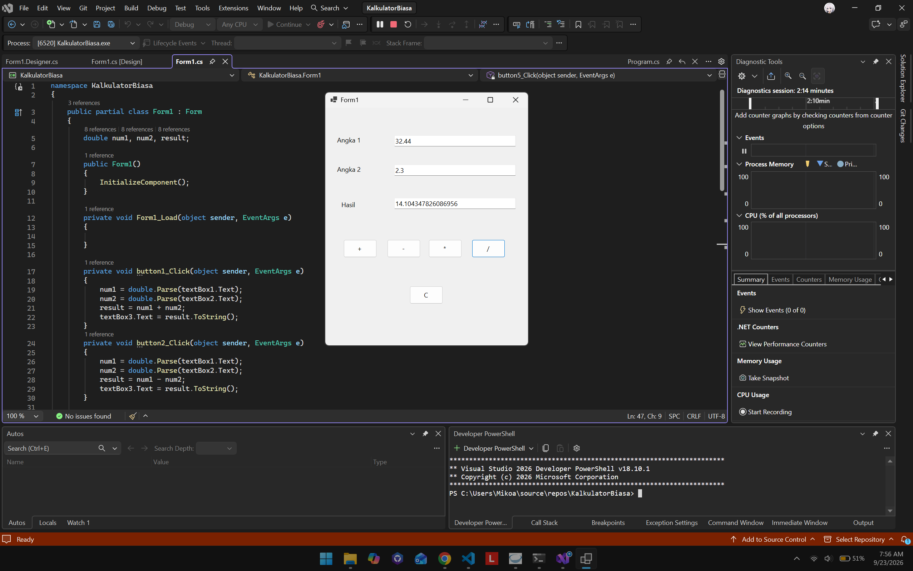
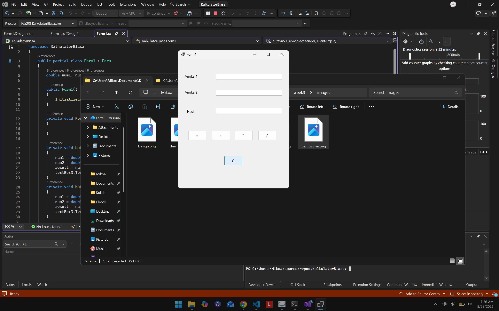

# Kalkulator Biasa - Windows Forms

Aplikasi **Kalkulator Biasa** adalah aplikasi desktop sederhana berbasis C# Windows Forms. Program ini menerima dua bilangan, menjalankan operasi aritmetika dasar, lalu menampilkan hasilnya pada form.

## Daftar Isi

- [Deskripsi](#deskripsi)
- [Tujuan Pembelajaran](#tujuan-pembelajaran)
- [Fitur](#fitur)
- [Tampilan Aplikasi](#tampilan-aplikasi)
- [Struktur Folder](#struktur-folder)
- [Komponen Antarmuka](#komponen-antarmuka)
- [Alur Kerja Program](#alur-kerja-program)
- [Penjelasan Implementasi](#penjelasan-implementasi)
- [Cara Menjalankan](#cara-menjalankan)
- [Cara Menggunakan](#cara-menggunakan)
- [Contoh Perhitungan](#contoh-perhitungan)
- [Catatan dan Batasan](#catatan-dan-batasan)

## Deskripsi

Kalkulator ini dibuat sebagai latihan dasar pemrograman GUI menggunakan C#. Pengguna mengisi nilai pada kolom **Angka 1** dan **Angka 2**, kemudian memilih tombol operasi. Nilai perhitungan ditampilkan pada kolom **Hasil**.

Program menggunakan model event-driven. Setiap tombol memiliki event `Click` yang membaca input, menghitung nilai, dan memperbarui output.

## Tujuan Pembelajaran

Melalui program ini, pengguna dapat mempelajari:

- Pembuatan form desktop menggunakan Windows Forms.
- Penggunaan `TextBox`, `Label`, dan `Button`.
- Pengaitan tombol dengan event handler `Click`.
- Pengambilan teks dari kontrol menggunakan properti `Text`.
- Konversi teks menjadi angka bertipe `double`.
- Operasi aritmetika dasar dan penampilan hasil ke form.
- Pemisahan kode tampilan/desain dan kode logika aplikasi.

## Fitur

| Fitur | Tombol | Keterangan |
| --- | --- | --- |
| Penjumlahan | `+` | Menjumlahkan Angka 1 dan Angka 2. |
| Pengurangan | `-` | Mengurangi Angka 1 dengan Angka 2. |
| Perkalian | `*` | Mengalikan Angka 1 dengan Angka 2. |
| Pembagian | `/` | Membagi Angka 1 dengan Angka 2. |
| Mengosongkan form | `C` | Menghapus Angka 1, Angka 2, dan Hasil. |

## Tampilan Aplikasi

### Desain Form

Tampilan form terdiri dari dua input angka, satu output hasil, empat tombol operasi, dan satu tombol untuk membersihkan input.



### Input Dua Bilangan

Masukkan bilangan pertama pada **Angka 1** dan bilangan kedua pada **Angka 2**.


### Operasi Penjumlahan

Tombol `+` menjalankan penjumlahan dua input.


### Operasi Pengurangan

Tombol `-` menjalankan pengurangan Angka 1 dengan Angka 2.



### Operasi Perkalian

Tombol `*` menjalankan perkalian dua input.


### Operasi Pembagian

Tombol `/` menjalankan pembagian Angka 1 dengan Angka 2.



### Tombol Clear

Tombol `C` mengosongkan seluruh kolom pada form.



## Struktur Folder

```text
week3/
|-- README.md
|-- images/
`-- KalkulatorBiasa/
    |-- Form1.cs
    |-- Form1.Designer.cs
    `-- Program.cs
```

### Penjelasan File

- `Program.cs`: titik masuk aplikasi. File ini menjalankan `Form1` melalui `Application.Run(new Form1())`.
- `Form1.cs`: berisi logika perhitungan dan event handler tombol.
- `Form1.Designer.cs`: berisi kode hasil Windows Forms Designer untuk membuat dan mengatur komponen form.
- `images/`: berisi dokumentasi visual berupa screenshot tampilan dan hasil pengujian operasi.
- `README.md`: dokumentasi proyek.

## Komponen Antarmuka

| Nama kontrol | Teks tampilan | Fungsi |
| --- | --- | --- |
| `textBox1` | - | Menerima nilai Angka 1. |
| `textBox2` | - | Menerima nilai Angka 2. |
| `textBox3` | - | Menampilkan Hasil. |
| `label1` | `Angka 1` | Label input pertama. |
| `label2` | `Angka 2` | Label input kedua. |
| `label3` | `Hasil` | Label output. |
| `button1` | `+` | Event `button1_Click` untuk penjumlahan. |
| `button2` | `-` | Event `button2_Click` untuk pengurangan. |
| `button3` | `*` | Event `button3_Click` untuk perkalian. |
| `button4` | `/` | Event `button4_Click` untuk pembagian. |
| `button5` | `C` | Event `button5_Click` untuk membersihkan form. |

## Alur Kerja Program

1. Aplikasi dimulai dari method `Main` di `Program.cs`.
2. `ApplicationConfiguration.Initialize()` menyiapkan konfigurasi aplikasi.
3. `Application.Run(new Form1())` membuka form kalkulator.
4. Pengguna mengisi `textBox1` dan `textBox2`.
5. Pengguna memilih salah satu tombol operasi.
6. Event handler mengambil teks input dan mengubahnya menjadi `double`.
7. Operasi aritmetika dijalankan.
8. Hasil dikonversi kembali menjadi teks dan dimasukkan ke `textBox3`.

Secara umum, alurnya dapat diringkas sebagai berikut:

```text
Input Angka 1 + Input Angka 2
		|
	Pilih operasi
		|
     Hitung nilai double
		|
	Tampilkan Hasil
```

## Penjelasan Implementasi

### Variabel Perhitungan

Pada `Form1.cs`, tiga variabel bertipe `double` digunakan untuk menyimpan nilai input dan hasil:

```csharp
double num1, num2, result;
```

Tipe `double` memungkinkan program menerima bilangan bulat maupun pecahan, misalnya `32.44` dan `2.3`.

### Membaca Input

Input pada `TextBox` berupa teks. Method `double.Parse` digunakan untuk mengubahnya menjadi angka:

```csharp
num1 = double.Parse(textBox1.Text);
num2 = double.Parse(textBox2.Text);
```

### Operasi Aritmetika

Setiap event handler melakukan operasi yang sesuai:

```csharp
result = num1 + num2; // tambah
result = num1 - num2; // kurang
result = num1 * num2; // kali
result = num1 / num2; // bagi
```

Setelah dihitung, hasil ditampilkan menggunakan:

```csharp
textBox3.Text = result.ToString();
```

### Membersihkan Input

Event tombol `C` mengatur teks ketiga `TextBox` menjadi string kosong:

```csharp
textBox1.Text = "";
textBox2.Text = "";
textBox3.Text = "";
```

## Cara Menjalankan

### Prasyarat

- Windows.
- Visual Studio dengan workload **.NET desktop development**.
- SDK/runtime .NET yang sesuai dengan konfigurasi proyek Windows Forms.

### Langkah Menjalankan di Visual Studio

1. Buka Visual Studio.
2. Buka project atau solution Windows Forms yang memuat folder `KalkulatorBiasa`.
3. Pastikan file `Program.cs`, `Form1.cs`, dan `Form1.Designer.cs` berada dalam project yang sama.
4. Jalankan project menggunakan tombol **Start** atau tekan `F5`.
5. Tunggu sampai form kalkulator muncul.

> Catatan: folder sumber yang disertakan pada repositori ini berisi file kode utama, tetapi tidak menyertakan file project seperti `.csproj`. Jika project belum tersedia, buat project **Windows Forms App** baru, lalu tambahkan ketiga file C# tersebut ke project.

## Cara Menggunakan

1. Isi kolom **Angka 1** dengan bilangan pertama.
2. Isi kolom **Angka 2** dengan bilangan kedua.
3. Klik tombol operasi yang diperlukan:
   - `+` untuk menjumlahkan.
   - `-` untuk mengurangkan.
   - `*` untuk mengalikan.
   - `/` untuk membagi.
4. Baca hasil pada kolom **Hasil**.
5. Klik `C` untuk menghapus semua input dan hasil sebelum melakukan perhitungan baru.

## Contoh Perhitungan

Misalnya:

- Angka 1 = `32.44`
- Angka 2 = `2.3`

Maka hasil operasi adalah:

| Operasi | Perhitungan | Hasil |
| --- | --- | ---: |
| Penjumlahan | `32.44 + 2.3` | `34.74` |
| Pengurangan | `32.44 - 2.3` | `30.14` |
| Perkalian | `32.44 * 2.3` | `74.612` |
| Pembagian | `32.44 / 2.3` | `14.104347826...` |

Hasil yang tampil dapat memiliki banyak angka desimal karena program menampilkan nilai `double` menggunakan `ToString()` tanpa pembatasan jumlah digit.

## Catatan dan Batasan

- Input harus berupa angka yang dapat dibaca oleh `double.Parse`. Input kosong atau teks nonangka dapat menyebabkan `FormatException`.
- Pembagian dengan angka kedua bernilai nol belum memiliki validasi khusus.
- Belum tersedia pembulatan atau pengaturan jumlah angka desimal.
- Kalkulator hanya menghitung dua bilangan dalam satu operasi.
- Tidak tersedia riwayat perhitungan, tombol backspace, atau ekspresi matematika bertingkat.

Batasan tersebut dapat dikembangkan pada versi berikutnya dengan `double.TryParse`, validasi input, pesan kesalahan, dan pengaturan format hasil.

## Teknologi

- Bahasa: C#
- Antarmuka: Windows Forms
- Komponen utama: `Form`, `Label`, `TextBox`, dan `Button`
- Paradigma interaksi: event-driven programming
