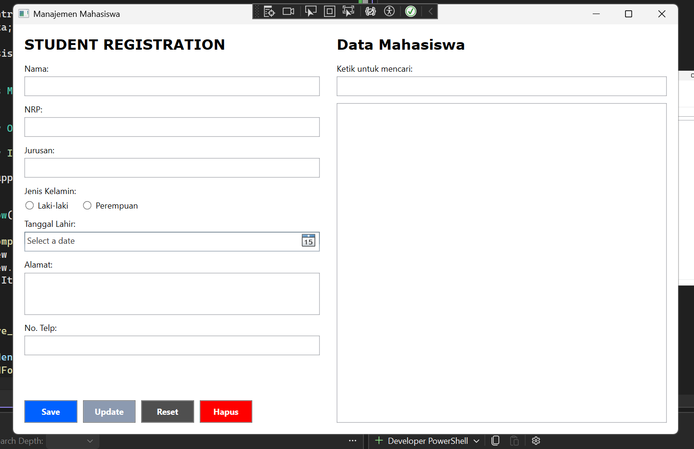
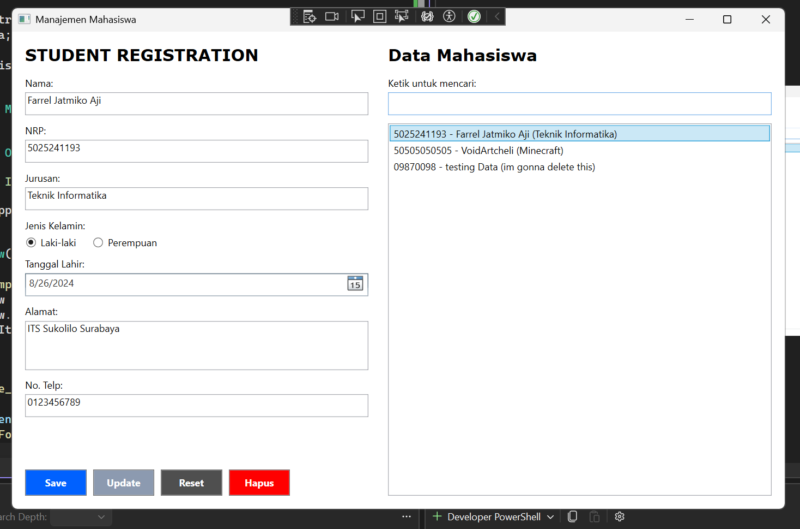
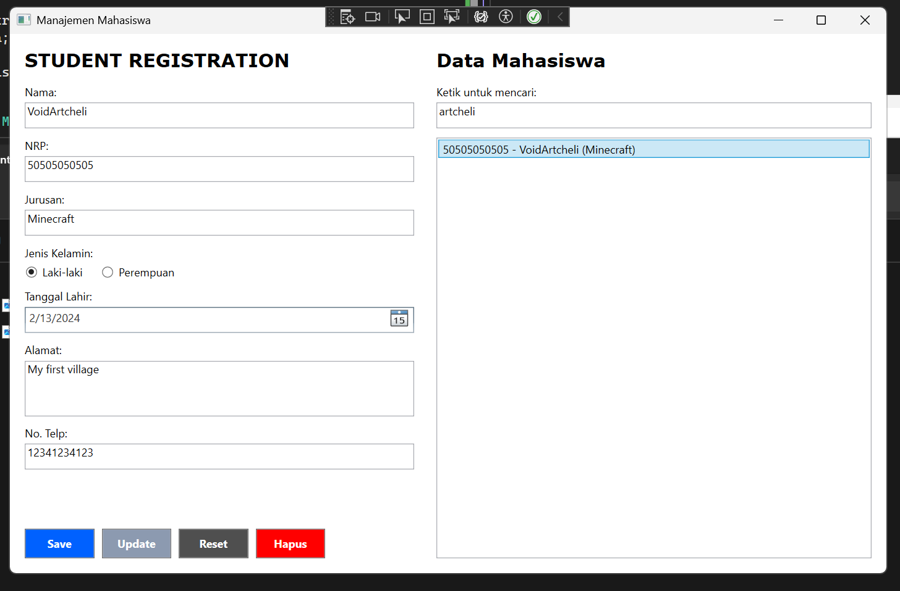
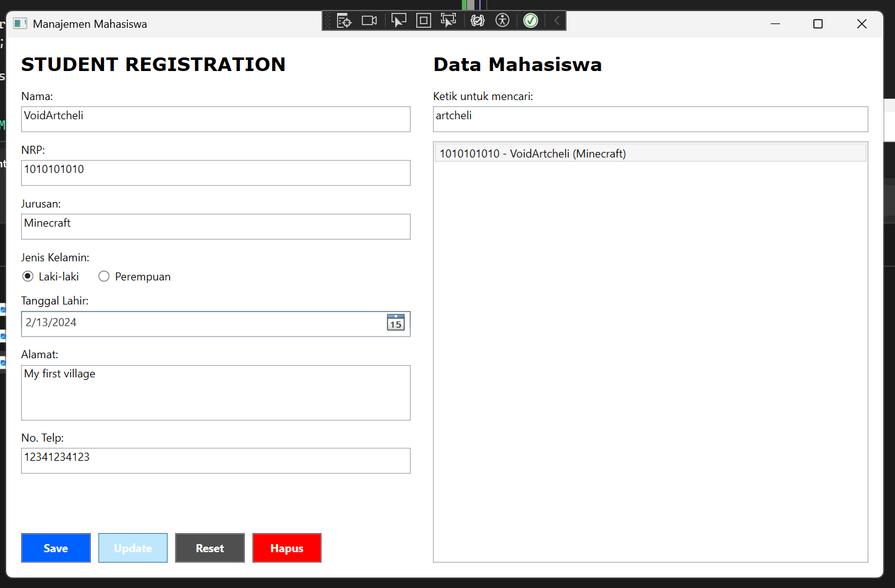
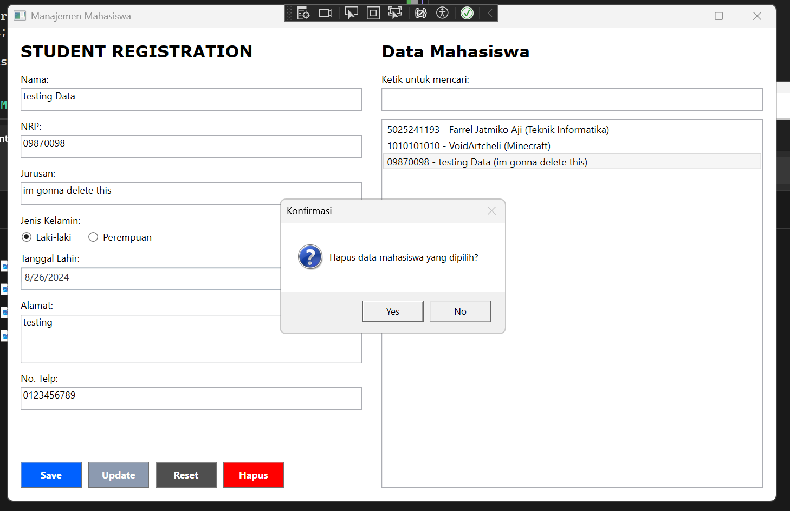
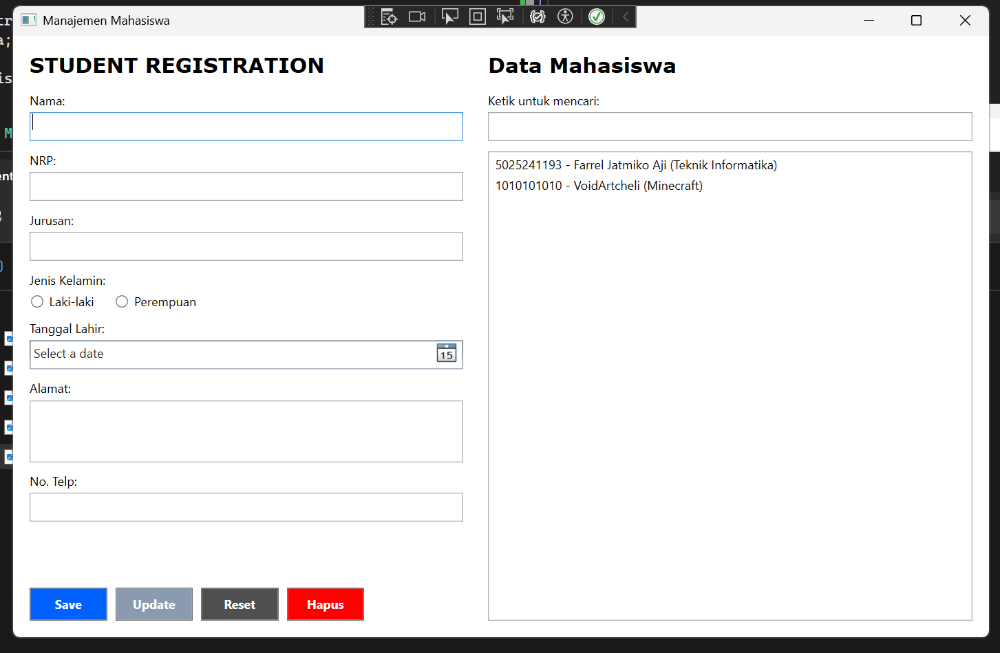

# Manajemen Mahasiswa WPF

Pada tugas ini saya membuat aplikasi desktop sederhana untuk mengelola data mahasiswa menggunakan WPF dan C#. Program ini memiliki form untuk memasukkan data mahasiswa dan daftar data yang bisa ditambah, diubah, dicari, serta dihapus.

- **Nama:** Farrel Jatmiko Aji
- **NRP:** 5025241193

## Tampilan Aplikasi



Pada tampilan awal, aplikasi dibagi menjadi dua bagian utama:

- **Student Registration:** bagian form untuk mengisi nama, NRP, jurusan, jenis kelamin, tanggal lahir, alamat, dan nomor telepon.
- **Data Mahasiswa:** bagian untuk menampilkan data yang sudah disimpan serta mencari data mahasiswa.

## Fitur

Fitur yang saya buat dalam program ini adalah:

- Menambahkan data mahasiswa baru melalui tombol **Save**.
- Menampilkan data mahasiswa pada daftar di sisi kanan.
- Memilih data pada daftar agar isinya muncul kembali di form.
- Mengubah data yang dipilih melalui tombol **Update**.
- Menghapus data dengan konfirmasi melalui tombol **Hapus**.
- Mengosongkan form melalui tombol **Reset**.
- Mencari data berdasarkan NRP, nama, atau jurusan.
- Memastikan semua field wajib diisi.
- Memastikan NRP tidak boleh sama dengan data yang sudah ada.

## Data yang Dikelola

Data mahasiswa yang saya gunakan memiliki beberapa atribut berikut:

| Atribut | Keterangan |
| --- | --- |
| Nama | Nama lengkap mahasiswa |
| NRP | Nomor registrasi pokok mahasiswa dan identitas unik |
| Jurusan | Program studi atau jurusan mahasiswa |
| Jenis Kelamin | Laki-laki atau Perempuan |
| Tanggal Lahir | Tanggal lahir mahasiswa |
| Alamat | Alamat tempat tinggal mahasiswa |
| No. Telp | Nomor telepon mahasiswa |

## Teknologi yang Digunakan

- C#
- Windows Presentation Foundation (WPF)
- .NET Framework 4.7.2
- Visual Studio / MSBuild
- `ObservableCollection<Student>` untuk menyimpan data selama aplikasi berjalan
- `ICollectionView` untuk filter pencarian

## Struktur File Program

```text
ManajemenMahasiswa_WPF/
├── App.xaml                 # Konfigurasi aplikasi WPF
├── App.xaml.cs              # Entry point aplikasi
├── MainWindow.xaml          # Layout dan kontrol antarmuka
├── MainWindow.xaml.cs       # Logika CRUD, validasi, dan pencarian
├── App.config               # Konfigurasi .NET Framework
└── ManajemenMahasiswa_WPF.csproj
```

## Penjelasan Kode Program

### `MainWindow.xaml`

File XAML saya gunakan untuk mengatur tampilan aplikasi menggunakan kontrol WPF. Form menggunakan `TextBox`, `RadioButton`, dan `DatePicker` untuk menerima data mahasiswa. `ListBox` digunakan untuk menampilkan daftar mahasiswa. Tombol **Save**, **Update**, **Reset**, dan **Hapus** dihubungkan ke event handler yang ada di file code-behind.

### `MainWindow.xaml.cs`

File ini berisi logika utama program, yaitu:

- `ObservableCollection<Student> _students` menyimpan data mahasiswa selama aplikasi berjalan.
- Konstruktor menghubungkan kumpulan data mahasiswa ke `ListBox` melalui `ICollectionView`.
- `Save_Click` membaca form, memvalidasi data, mengecek NRP duplikat, lalu menambahkan data baru.
- `Update_Click` memperbarui data mahasiswa yang sedang dipilih.
- `Delete_Click` menghapus data setelah pengguna memberikan konfirmasi.
- `ResetForm` mengosongkan seluruh input dan membatalkan pilihan pada daftar.
- `StudentList_SelectionChanged` mengisi form berdasarkan data yang dipilih dari daftar.
- `SearchBox_TextChanged` menjalankan refresh filter ketika teks pencarian berubah.
- `FilterStudents` mencocokkan kata kunci dengan NRP, nama, atau jurusan.

### Class `Student`

Class `Student` digunakan sebagai model data mahasiswa. Class ini memiliki properti `Nrp`, `Name`, `Major`, `Gender`, `BirthDate`, `Address`, dan `Phone`. Method `ToString()` mengatur format singkat data yang ditampilkan pada daftar, yaitu NRP, nama, dan jurusan.

### Penjelasan alur program

File `MainWindow.xaml` digunakan untuk membuat tampilan aplikasi. Pada file ini terdapat `Grid` sebagai pembagi layout, `TextBox` untuk input nama, NRP, jurusan, alamat, dan nomor telepon, serta `RadioButton` untuk memilih jenis kelamin. `DatePicker` digunakan untuk memilih tanggal lahir. Di bagian kanan terdapat `ListBox` yang menampilkan data mahasiswa dan `SearchBox` yang digunakan untuk pencarian.

Setiap tombol di XAML dihubungkan dengan event handler pada file `MainWindow.xaml.cs`. Contohnya, tombol **Save** menjalankan method `Save_Click`, tombol **Update** menjalankan `Update_Click`, tombol **Reset** menjalankan `Reset_Click`, dan tombol **Hapus** menjalankan `Delete_Click`. Dengan pembagian ini, XAML berfungsi sebagai tampilan, sedangkan file `.cs` berisi proses pengolahan datanya.

### Proses menyimpan data

Data mahasiswa disimpan di dalam `ObservableCollection<Student>` yang bernama `_students`. Collection ini digunakan karena daftar pada tampilan dapat ikut diperbarui ketika ada data yang ditambahkan atau dihapus. Pada saat aplikasi pertama kali dibuka, collection masih kosong.

Ketika tombol **Save** ditekan, method `Save_Click` memanggil `TryReadForm`. Method tersebut membaca semua nilai pada form dan memeriksa apakah nama, NRP, jurusan, jenis kelamin, tanggal lahir, alamat, dan nomor telepon sudah diisi. Jika ada data yang kosong, program menampilkan pesan validasi dan proses dihentikan.

Jika semua input sudah lengkap, nilai tersebut dibuat menjadi object `Student`. Sebelum object ditambahkan, program mengecek NRP menggunakan method `Any`. Pengecekan ini dilakukan supaya tidak ada dua mahasiswa dengan NRP yang sama. Jika NRP belum digunakan, object mahasiswa ditambahkan dengan `_students.Add(student)` dan form dikosongkan melalui `ResetForm`.

### Proses menampilkan dan memilih data

Pada konstruktor `MainWindow`, collection `_students` dihubungkan ke `StudentList` menggunakan `ICollectionView`. `StudentList.ItemsSource` diisi dengan view tersebut sehingga setiap data yang ada di collection dapat ditampilkan dalam bentuk daftar.

Ketika pengguna memilih salah satu data di `ListBox`, event `StudentList_SelectionChanged` dijalankan. Program mengambil object yang dipilih melalui `StudentList.SelectedItem`, kemudian memasukkan nilainya kembali ke kontrol form seperti `Nama.Text`, `NRP.Text`, `Jurusan.Text`, dan kontrol lainnya. Dengan begitu, pengguna dapat melihat dan mengedit data yang dipilih tanpa mengisi ulang dari awal.

### Proses mengubah data

Method `Update_Click` pertama-tama memeriksa apakah pengguna sudah memilih data. Jika belum ada data yang dipilih, program menampilkan pesan informasi. Jika sudah ada, program membaca data baru dari form menggunakan `TryReadForm`.

Program juga mengecek NRP untuk memastikan NRP baru tidak sama dengan NRP milik mahasiswa lain. Setelah validasi berhasil, nilai `Nrp`, `Name`, `Major`, `Gender`, `BirthDate`, `Address`, dan `Phone` pada object yang dipilih diperbarui. Setelah itu, `_studentsView.Refresh()` dipanggil agar perubahan langsung terlihat pada daftar mahasiswa.

### Proses menghapus data

Method `Delete_Click` digunakan untuk menghapus data. Program memastikan terlebih dahulu bahwa ada item yang dipilih. Setelah itu, `MessageBox.Show` menampilkan konfirmasi dengan pilihan **Yes** dan **No**. Data hanya dihapus jika pengguna menekan **Yes**.

Penghapusan dilakukan dengan `_students.Remove(selectedStudent)`. Setelah data berhasil dihapus, `ResetForm` dipanggil agar pilihan pada daftar dan seluruh input form kembali kosong. Konfirmasi ini digunakan untuk menghindari penghapusan data secara tidak sengaja.

### Proses pencarian data

Pencarian dilakukan menggunakan `ICollectionView`. Setiap kali pengguna mengetik pada `SearchBox`, event `SearchBox_TextChanged` memanggil `_studentsView.Refresh()`. Pemanggilan tersebut menjalankan ulang method `FilterStudents`.

Pada `FilterStudents`, kata kunci dari `SearchBox.Text` dibandingkan dengan NRP, nama, dan jurusan. Pencarian menggunakan `IndexOf` dengan `StringComparison.OrdinalIgnoreCase`, sehingga pencarian tidak membedakan huruf besar dan huruf kecil. Jika kata kunci ditemukan pada salah satu atribut tersebut, data tetap ditampilkan pada `ListBox`.

### Validasi dan reset form

Method `TryReadForm` menjadi bagian utama validasi input. Selain memeriksa field kosong, method ini juga menentukan nilai jenis kelamin berdasarkan `LakiLakiRadio.IsChecked` atau `PerempuanRadio.IsChecked`. Jika belum ada pilihan jenis kelamin atau tanggal lahir belum dipilih, data dianggap belum lengkap.

Method `ResetForm` digunakan untuk membersihkan seluruh input, menghapus pilihan pada `StudentList`, dan mengembalikan fokus ke field nama. Variabel `_suppressSelectionChanged` digunakan saat proses reset agar perubahan pilihan pada `ListBox` tidak mengisi kembali data ke form.

### Penyimpanan data

Pada program ini, data belum disimpan ke database atau file. Semua data hanya berada di dalam `ObservableCollection` selama aplikasi berjalan. Karena itu, data akan kembali kosong ketika program ditutup. Penyimpanan permanen dapat ditambahkan pada pengembangan berikutnya, misalnya menggunakan database atau file JSON.

## Demo Program

Berikut adalah hasil demo dari program yang telah saya buat.

### Tampilan awal

Pada tampilan awal, pengguna dapat mengisi data mahasiswa pada form di sebelah kiri. Di sebelah kanan terdapat daftar mahasiswa dan kolom pencarian.


### Menambahkan data mahasiswa

Setelah semua field diisi dan jenis kelamin dipilih, tombol **Save** digunakan untuk menyimpan data. Data yang berhasil disimpan akan muncul pada daftar mahasiswa di sebelah kanan.



Program juga memberikan validasi jika ada field yang belum diisi atau jika NRP yang dimasukkan sudah digunakan.

### Mencari data

Fitur pencarian dapat digunakan dengan mengetik kata kunci pada kolom **Ketik untuk mencari**. Daftar akan langsung menampilkan data yang sesuai berdasarkan NRP, nama, atau jurusan.



### Mengubah data

Data yang ada di daftar dapat dipilih untuk dimuat kembali ke form. Setelah isi data diubah, tombol **Update** digunakan untuk menyimpan perubahan tersebut.



### Menghapus data

Untuk menghapus data, pengguna memilih data pada daftar lalu menekan tombol **Hapus**. Program menampilkan pesan konfirmasi sebelum data benar-benar dihapus.



Setelah penghapusan selesai, data tersebut tidak lagi ditampilkan pada daftar.



## Validasi dan Catatan Program

- Semua field pada form harus diisi.
- NRP dibandingkan tanpa membedakan huruf besar dan kecil serta harus unik.
- Update hanya dapat dilakukan setelah salah satu data pada daftar dipilih.
- Delete hanya dapat dilakukan setelah data dipilih dan dikonfirmasi.
- Data disimpan sementara di memori menggunakan `ObservableCollection`. Oleh karena itu, data akan kembali kosong ketika program ditutup.

## Lisensi

Program ini dibuat untuk memenuhi tugas pembelajaran mata kuliah PBKK.
